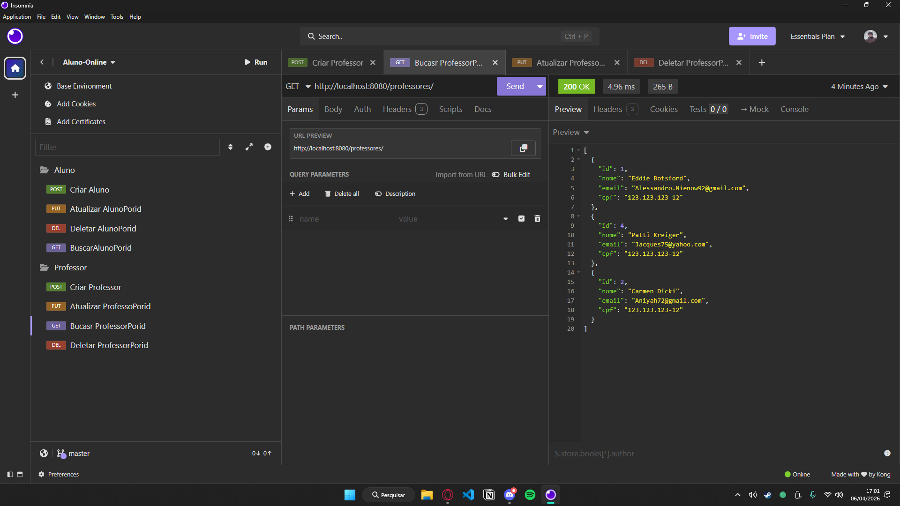
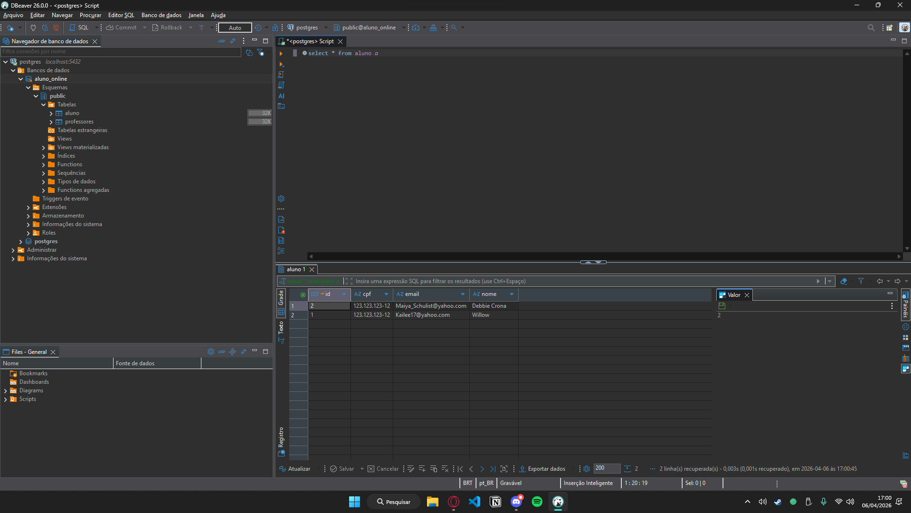

# API Aluno Online

Solução de backend voltada para a administração escolar, permitindo o controle centralizado de informações sobre o corpo docente e discente.

## Recursos Principais

A API disponibiliza operações de **CRUD** para a gestão das entidades da escola:

* **Alunos:** Cadastro, consulta, atualização e exclusão de estudantes.
* **Professores:** Registro e manutenção dos dados dos professores da instituição.
* **Disciplinas:** Cadastro de disciplinas vinculadas a um professor.
* **Matrículas:** Matrícula de alunos em disciplinas, lançamento de notas, trancamento e histórico do aluno (com média por disciplina).

Além disso, a API conta com:

* 🔒 **Autenticação e autorização** com Spring Security.
* 📖 **Documentação interativa** com Swagger (OpenAPI).
* 🗄️ **Versionamento do banco de dados** com Flyway.

## Stack Tecnológica

* **Linguagem:** Java 21
* **Framework Principal:** Spring Boot 4
* **Acesso a Dados:** Spring Data JPA
* **Banco de Dados:** PostgreSQL
* **Migrations:** Flyway
* **Segurança:** Spring Security (HTTP Basic)
* **Documentação:** springdoc-openapi (Swagger UI)
* **Testes:** JUnit 5, MockMvc e H2 em memória
* **Automação de Build:** Maven (com Maven Wrapper)

## Arquitetura do Sistema

O projeto adota o padrão **MVC (Model-View-Controller)** para garantir modularidade e facilitar a manutenção do código:

* `controllers/`: Ponto de entrada da API, lida com as rotas e respostas HTTP.
* `services/`: Concentra as regras de negócio e validações da aplicação.
* `models/`: Define a estrutura das entidades e o mapeamento do banco de dados.
* `models/dtos/`: Objetos de transferência de dados (notas, histórico do aluno).
* `repositories/`: Interface de comunicação direta com a camada de persistência.
* `config/`: Configurações de segurança (`SecurityConfig`) e do Swagger (`OpenApiConfig`).
* `resources/db/migration/`: Scripts SQL do Flyway.
* `AlunoOnlineApplication.java`: Classe principal que inicializa o contexto do Spring Boot.

## 🚀 Como Rodar

**Pré-requisitos:** Java 21+ e PostgreSQL rodando em `localhost:5432` com um banco chamado `aluno_online`.

1. Ajuste usuário e senha do banco em `Java-Project/src/main/resources/application.properties`.
2. Na pasta `Java-Project`, suba a aplicação:

```bash
./mvnw spring-boot:run
```

No Windows (cmd/PowerShell), use `mvnw.cmd spring-boot:run`.

Para rodar os testes (não precisam do PostgreSQL, usam H2 em memória):

```bash
./mvnw test
```

## 🔒 Segurança (Spring Security)

A API usa autenticação **HTTP Basic**: usuário e senha são enviados em cada requisição.

| Rota | Quem pode acessar |
|---|---|
| Swagger (`/swagger-ui.html`, `/v3/api-docs`) | Público |
| Consultas (`GET`) | `usuario` ou `admin` |
| Criar, alterar e apagar (`POST`, `PUT`, `PATCH`, `DELETE`) | Somente `admin` |

**Usuários padrão (ambiente de desenvolvimento):**

| Usuário | Senha | Perfil |
|---|---|---|
| `admin` | `admin123` | ADMIN |
| `usuario` | `usuario123` | USER |

As credenciais podem ser trocadas pelas variáveis de ambiente `ADMIN_USERNAME`, `ADMIN_PASSWORD`, `USER_USERNAME` e `USER_PASSWORD`.

Respostas possíveis:
* `401 Unauthorized`: sem login ou senha errada.
* `403 Forbidden`: logado, mas sem permissão (ex.: `usuario` tentando criar um aluno).

Exemplo com `curl`:

```bash
curl -u admin:admin123 http://localhost:8080/alunos/
```

No Insomnia/Postman, escolha **Auth → Basic Auth** e informe usuário e senha.

## 📖 Documentação (Swagger)

Com a aplicação rodando, acesse:

* **Swagger UI:** http://localhost:8080/swagger-ui.html
* **OpenAPI (JSON):** http://localhost:8080/v3/api-docs

Clique em **Authorize**, informe usuário e senha e teste os endpoints direto pelo navegador.

## 🗄️ Banco de Dados (Flyway)

As tabelas são criadas e versionadas pelo **Flyway**, a partir dos scripts em `src/main/resources/db/migration`:

* `V1__criar_tabelas.sql`: cria `aluno`, `professores`, `disciplinas` e `matricula_aluno`.

Regras:
* Toda mudança no banco vira um **novo arquivo** (`V2__descricao.sql`, `V3__...`). Nunca edite uma migration que já rodou.
* O Hibernate está em `ddl-auto=validate`: ele não altera o banco, só confere se as entidades batem com as tabelas.
* Se o banco já tinha as tabelas (criadas antes pelo `ddl-auto=update`), o Flyway marca a V1 como aplicada automaticamente (`baseline-on-migrate`).

## 📌 Endpoints

### Alunos (`/alunos`)
| Método | Rota | Descrição |
|---|---|---|
| POST | `/alunos/create` | Cria um aluno |
| GET | `/alunos/` | Lista todos os alunos |
| GET | `/alunos/{id}` | Busca aluno por id |
| PUT | `/alunos/{id}` | Atualiza aluno |
| DELETE | `/alunos/{id}` | Remove aluno |

### Professores (`/professores`)
| Método | Rota | Descrição |
|---|---|---|
| POST | `/professores/create` | Cria um professor |
| GET | `/professores/` | Lista todos os professores |
| GET | `/professores/{id}` | Busca professor por id |
| PUT | `/professores/{id}` | Atualiza professor |
| DELETE | `/professores/{id}` | Remove professor |

### Disciplinas (`/disciplina`)
| Método | Rota | Descrição |
|---|---|---|
| POST | `/disciplina/create` | Cria uma disciplina |
| GET | `/disciplina/foundall` | Lista todas as disciplinas |
| GET | `/disciplina/{id}` | Busca disciplina por id |
| GET | `/disciplina/professor/{professorId}` | Lista disciplinas de um professor |
| DELETE | `/disciplina/delete/{id}` | Remove disciplina |

### Matrículas (`/matricula-aluno`)
| Método | Rota | Descrição |
|---|---|---|
| POST | `/matricula-aluno/create` | Matricula um aluno em uma disciplina |
| PATCH | `/matricula-aluno/update-grades/{id}` | Lança/atualiza as notas |
| PATCH | `/matricula-aluno/update-status/{id}` | Tranca a matrícula |
| GET | `/matricula-aluno/historico-aluno/{id}` | Histórico do aluno com notas e médias |

## 👁️ Visão Geral da Implementação

A aplicação utiliza as melhores práticas do ecossistema Java para oferecer uma API robusta e escalável.

### 1. Mapeamento Objeto-Relacional (Entities)
As entidades em `models/` são mapeadas para o banco de dados via **JPA**.
* **Mapeamento:** Através das anotações `@Entity`, `@Table` e `@Id`, cada classe corresponde a uma tabela criada pelas migrations do Flyway.
* **Produtividade com Lombok:** Reduz o código repetitivo (*boilerplate*) gerando automaticamente métodos acessores e construtores.

### 2. Abstração de Dados (Repositories)
A utilização do `JpaRepository` elimina a complexidade de consultas manuais. A interface permite que operações como busca, salvamento e remoção sejam executadas de forma nativa, aumentando a segurança e performance das queries.

### 3. Lógica de Domínio (Services)
Esta camada atua como o "cérebro" do sistema. No fluxo de atualização, por exemplo, o serviço garante a integridade dos dados, verificando a existência do registro e aplicando apenas as mudanças necessárias antes de persistir no banco.

### 4. Gestão de Endpoints (Controllers)
Os controladores expõem as funcionalidades para o mundo externo, utilizando os métodos HTTP de forma semântica:
* `@PostMapping`: Para inserção de novos recursos.
* `@GetMapping`: Para recuperação de informações.
* `@PutMapping` / `@PatchMapping`: Para modificação de registros.
* `@DeleteMapping`: Para encerramento de registros.
* `@RequestBody`: Realiza o *parsing* automático de objetos JSON enviados pelo cliente para objetos Java.

### 5. Segurança (Config)
O `SecurityConfig` define uma `SecurityFilterChain` sem sessão (stateless), com senhas criptografadas em **BCrypt** e regras de acesso por perfil (`USER` e `ADMIN`).

## Prints do Projeto 👍

<div align-items="center">
 
 
  
  
</div>
